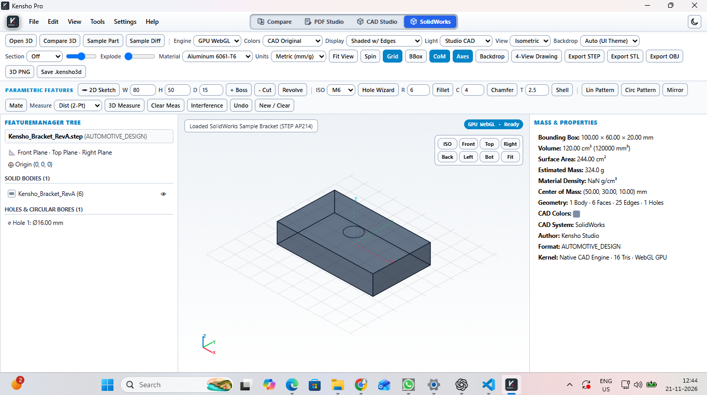

# Kensho Pro 1.0 — Enterprise-Grade Engineering Review & Compare Studio

**Publisher / Developer:** Kensho Studio · [textportdocx.in](https://textportdocx.in)  
**Version:** 1.2.3.2<br>
**License:** 100% Free for both commercial and personal engineering use.  
**Privacy & Security:** 100% Offline. Zero telemetry, zero network calls, zero external API dependencies. All PDF, CAD, and CAM operations run completely client-side in pure JavaScript and Web Workers.

---

## Overview

Kensho Pro 1.0 transforms the application from a standard drawing diff tool into a complete, lightweight, Swiss Army Knife engineering review workbench (industrial PDF markup and PCB CAM engineering workbench, completely free and offline).

## Application Preview



The SolidWorks Studio workspace combines a categorized toolbar, feature manager tree, interactive 3D CAD viewport, and mass and properties panel in one engineering review interface.

---

## What's New in Version 1.2.3.2

### Module 1: Crisp Modern UI & Floating/Dockable Compare Layer Manager
- **Categorized Ribbon Bar:** Clean tabbed ribbon bar organizing engineering tools:
  - `Review & Compare`: Open Base (Rev A), Open New (Rev B), Auto-Align, View Modes, Jump to Defect.
  - `View & Enhance`: Normal, High Contrast Boost, Blueprint Dark CAD, Split Curtain, Invert, 100% Sharp Zoom.
  - `Markup & Stamps`: Revision Cloud, Leader Arrow, Callout, Dynamic Stamp, Freehand Pen, Redact.
  - `Measure (OSNAP)`: Calibrate Scale, Distance, Polyline, Area, Tally / BOM Counter.
  - `CAD & CAM`: Import DXF, Export DXF, PCB CAM Compare (Gerber/Drill), 4-mil Clearance.
  - `Export & Share`: Save PDF with Diffs, Export High-Res Image, Export .dxf, Executive Audit Report, Session .redline.
- **Moveable & Dockable Compare Layer Panel:** Floating, draggable, dockable panel with:
  - Solo Eye button, Opacity slider (0–100%), and Tint color picker for Layer A (Base) and Layer B (Revised).
  - Diff Layer toggle (+Green additions / −Red deletions) and sensitivity threshold slider.
  - Micro-Align controls with 1px and 0.1px step nudge buttons and rotational compensation.
- **Interactive Curtain Split Slider:** Smooth 60 FPS viewport divider showing pure Rev A on the left and Rev B on the right without re-rasterizing the underlying pages.
- **Resizable & Collapsible Sidebar:** 4px draggable splitter with collapse toggle (`[◀◀]` / `Ctrl+B`) that persists user width.

### Module 2: Precision Auto-Alignment & "Jump-to-Defect" Navigator
- **Sub-Pixel Auto-Alignment:** Automated feature/corner anchor matcher detecting translation `(dx, dy)` and rotational skew `(dθ)`.
- **3-Point Fiducial Snap Tool:** User clicks 3 matching reference points (e.g. schematic grid corners or PCB mounting holes) on Rev A and Rev B to calculate affine transform and snap pages with sub-pixel precision.
- **Smart "Jump-to-Defect" Navigator:**
  - Contiguous diff pixel clustering with configurable noise threshold (1–10 px) filtering out antialiasing noise.
  - Next Defect (`N` / `F3`) and Previous Defect (`P` / `Shift+F3`) keyboard navigation smoothly centering and zooming each defect.
  - Sidebar Defect Checklist marking each issue as `[Open]` | `[Approved]` | `[Flagged]` | `[Ignored]`.

### Module 3: Offline Bi-Directional CAD (DXF) Engine
- **PDF to CAD (.dxf) Export:** Extracts PDF vector drawing paths and text via PDF.js operator list (`OPS.constructPath`, `moveTo`, `lineTo`, `curveTo`, `showText`) into standard AutoCAD R12/2000 ASCII DXF.
  - Units modal supporting Millimeters (`mm`, `$INSUNITS = 4`), Mils (`mils`, `$INSUNITS = 10`), Inches (`in`, `$INSUNITS = 1`), and Scale Presets (1:1, 1:50, 1:100, 1:1000).
  - Semantic layer classification: `SHEET_BORDER`, `GEOMETRY`, `TEXT`, `REDLINE_DIFFS`.
- **CAD (.dxf) to PDF/Canvas Import:** Native client-side ASCII DXF parser for `LINE`, `POLYLINE`, `LWPOLYLINE`, `CIRCLE`, `ARC`, `TEXT`, and `MTEXT`.

### Module 4: Industrial PCB CAM Engine (Gerber RS-274X & Excellon Drill)
- **Gerber RS-274X Parser:** Coordinates (`%FS...%`), units (`%MOIN*%` / `%MOMM*%`), standard apertures (`%ADD...%` Circle, Rectangle, Obround, Polygon), D01/D02/D03 commands, and G01/G02/G03 interpolation.
- **Excellon NC Drill Parser:** Tool definitions (`T01C...`), coordinates `X...Y...`, and drill hit mapping.
- **High-Contrast PCB Copper Rendering:** Dark Green substrate base, Copper traces, and Gold ENIG pads.
- **CAM vs. PDF & Gerber vs. Gerber Compare:**
  - Red: Missing copper / missing drill holes.
  - Green: Added copper / extra drill holes.
  - Amber / Yellow: Clearance warning (spacing violations below 4 mils / 0.1 mm).

### Module 5: Engineering Measurement & Markup Suite (OSNAP)
- **Precision Calibration & Measurement:**
  - Scale calibration against known dimension lines with pixel-to-unit ratio storage.
  - Distance & Cumulative Polyline tool for multi-segment pipe and wire runs.
  - Closed polygon Area & Perimeter tool with live readout (Shoelace formula).
  - Magnetic Object Snap (OSNAP): Snapping cursor to nearest vertices (square), midpoints (triangle), and center points (circle) within 8px radius.
  - Tally & BOM Counter: Inspection badges (`#1`, `#2`, `#3`...) with automated tally list and CSV export.
- **Professional Markups & Dynamic Stamps:**
  - ANSI/ISO-standard scalloped revision clouds with Revision Delta triangles (`Δ Rev 2`).
  - Leader Callouts: Multi-point arrows with auto-wrapping text callout boxes.
  - Dynamic Engineering Stamps: Vector stamps (`APPROVED`, `REJECTED`, `REVISED & RESUBMIT`, `FOR REVIEW ONLY`) stamped with current date, time, reviewer name, and cryptographic SHA-256 document hash.

### Module 6: Virtual Viewport Memory Optimization & Audit Reports
- **512x512 Virtual Tiling:** Large high-density schematics (A0/E-size sheets) rendered in virtual tiles; off-screen canvases are automatically disposed from LRU cache to prevent memory exhaustion.
- **Dedicated Web Worker:** Heavy pixel diffing and connected region calculations offloaded to background Web Workers.
- **Session Save (`.redline`):** JSON-based project file storing document paths, diff classifications, reviewer notes, defect approvals, and measurement calibrations.
- **Executive Summary PDF Audit Report:** Multi-page PDF report with document metadata, comparison statistics, full-sheet thumbnail, and itemized defect checklist with running headers and footers "Kensho Studio · textportdocx.in".
- **Excel/CSV Defect Export:** Structured export of defect IDs, page numbers, coordinates, statuses, and reviewer notes.

---

## File Architecture

| File | Module / Responsibility |
|---|---|
| `dxf_engine.js` | Module 3: AutoCAD R12/2000 ASCII DXF export and import engine |
| `cam_engine.js` | Module 4: Gerber RS-274X, Excellon NC Drill parser, PCB copper renderer, 4-mil clearance check |
| `measure_engine.js` | Module 5: Scale calibration, OSNAP, distance, polyline, area, tally BOM counter, revision clouds, SHA-256 stamps |
| `worker_engine.js` | Module 6: 512x512 virtual tile grid, memory manager, and Web Worker RPC bridge |
| `worker.js` | Module 6: Dedicated background Web Worker for heavy pixel diffing and cluster labeling |
| `ui_ribbon.js` | Module 1 & 2: Categorized ribbon tabs, floating layer dock, curtain slider, fiducial align, defect navigator |
| `pro.js` | Pro additions: Enhanced views (contrast/blueprint), sharp zoom (`#hq`), panel resizers, system hooks |
| `app.js` | Compare engine (`window.CMP`), pixel diffing, layer classification, zoom/pan transforms |
| `editor.js` | Annotation and markup workspace (`window.RE`) |
| `extras.js` | Editor tabs, context menus, auto-save recovery, text LCS diff, batch compare |
| `main.js` | Electron main process, IPC handlers, CLI arguments (`--compare`), window management |
| `preload.js` | Secure IPC bridge (`window.native`) |
| `installer.nsi` | NSIS installer script with Windows Explorer shell context menu integration |
| `style.css` | Complete stylesheet for workspace, ribbons, docks, curtains, and dialogs |
| `index.html` | Workspace markup |

---

## Running from Source

Requires Node.js 18 or newer:

```bash
npm install
npm start
```

## Packaging for Distribution (Windows & Linux)

### 1. Windows (Portable `.exe` & NSIS Setup `.exe`)

```bash
# 1-Click Windows Build (Portable + Setup Installer)
npm run dist:all
# Or run: Build-Windows-EXEs.bat
```

Outputs in `dist/`:
- `dist/KenshoPro-Portable-1.2.3.2.exe` — Standalone single-file Windows Portable executable.
- `dist/KenshoPro-Setup-1.2.3.2.exe` — Full Windows NSIS Setup Installer with Desktop/Start Menu shortcuts, `.pdf`/`.dxf`/`.gbr`/`.drl`/`.ipc`/`.redline` file associations, and Windows Explorer *"Compare with Kensho Pro"* right-click context menu.

### 2. Linux (Portable `.AppImage` / `.tar.gz` & Setup `.deb` / `.run` / `install-linux.sh`)

```bash
# 1-Click Linux Build (AppImage + Portable tar.gz + Debian/Ubuntu .deb + Universal .run Setup)
./Build-Linux-Packages.sh
# Or via npm:
npm run dist:linux
```

Outputs in `dist/`:
- **Linux Portable:**
  - `dist/KenshoPro-Portable-1.2.3.2-x86_64.AppImage` — Universal single-file Linux Portable binary (`chmod +x` and run on any distro).
  - `dist/KenshoPro-Portable-1.2.3.2-linux-x64.tar.gz` — Self-contained Portable bundle with `./KenshoPro-Portable.sh` (stores user profile/session data in local `./portable-data/` for USB/air-gapped use).
- **Linux Setup / Installers:**
  - `dist/KenshoPro-Setup-1.2.3.2-amd64.deb` — Native Debian / Ubuntu / Linux Mint / Pop!_OS Setup package (`sudo apt install ./dist/KenshoPro-Setup-1.2.3.2-amd64.deb`).
  - `dist/KenshoPro-Setup-1.2.3.2-linux-x64.run` — Self-extracting universal Linux Setup installer for Ubuntu, Debian, Fedora, RHEL, Arch, and openSUSE (`./dist/KenshoPro-Setup-1.2.3.2-linux-x64.run` for rootless user install or `sudo ./dist/KenshoPro-Setup-1.2.3.2-linux-x64.run` for system-wide `/opt/KenshoPro` install).
  - `./install-linux.sh` — Direct setup & uninstaller script supporting `--user`, `--system`, and `--uninstall`, registering the XDG `.desktop` launcher, 512×512 icon, MIME types, `kensho-pro` CLI command, and Nautilus/Nemo *"Compare with Kensho Pro"* right-click action.
